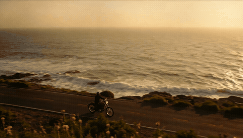
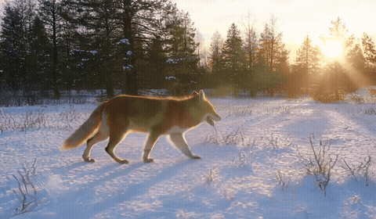

# LTX-2.5 on one 16 GB GPU

[Lightricks LTX-2.5](https://huggingface.co/Lightricks/LTX-2.5) — 22B text/image-to-video **with synchronized sound** — as our
[16gb hibrid](https://huggingface.co/myllmbox/LTX-2.5-16gb-hibrid) repack on a single RTX 50-series card with 16 GB.
**1080p up to 8 s, 1280×704 up to 18.7 s, 768×448 up to 50 s. A 5 s 720p clip in 125 s.** One command.

LTX-2.x Community License — free below USD 10M annual revenue. Built on LTX-2.5 by Lightricks.

| [](assets/motorcycle-1080p-5s.mp4) | [](assets/paper-boats-720p-5s.mp4) | [](assets/fox-448p-50s.mp4) |
|---|---|---|
| 1920×1088 · 5 s | 1280×704 · 5 s | 768×448 · **50 s** |

Click a preview for the full clip with sound.

## Measured (RTX 5080 16 GB, 16 GB system RAM + 4 GB swap, 24 fps, with sound)

Render time per clip:

| size | 5 s | 10 s | 15 s | longest clip |
|---|---|---|---|---|
| **1920×1088** | 181 s | — | — | **8 s** · 257 s |
| **1280×704** | 125 s | 162 s | 233 s | **18.7 s** · 256 s |
| **1024×576** | 120 s | 134 s | 160 s | **29 s** · 268 s |
| **768×448** | 111 s | 120 s | 134 s | **50 s** · 263 s |

The first clip after a start also reads the weights from disk. Portrait sizes (704×1280, …) fit the same lengths.

## What fits

- **Any size** in multiples of 64 and any length of 8k+1 frames (121 = 5 s at 24 fps).
- **Before anything renders**, the server checks the request against your GPU and free RAM. A clip past the limit gets
  `400` with the longest that fits: *"1280x704 fits up to 449 frames (18.7 s at 24 fps)"*. Bigger cards get longer clips
  automatically.
- **Images:** up to 4 conditioning images — the first becomes frame 0, the second the last frame (or any frame you name).

## Quick start

```bash
git clone https://github.com/myllmbox/ltx-25-16gb-recipe.git
cd ltx-25-16gb-recipe
./run.sh        # first run downloads ~47G, then serves on :8000 and renders ./smoke.mp4
```

`./stop.sh` stops it. `./view.sh` shows the live log. Requirements: Linux, docker + the NVIDIA container toolkit, driver 590
or newer, a Blackwell GPU (RTX 50-series) with 16 GB that nothing else uses, 16 GB of system RAM (plus a few GB of swap for the
longest clips), ~50 GB of disk.

**All configuration lives in [`recipe.yaml`](recipe.yaml)** — image, weights, port, default size and length.

## API

```bash
# text → video (5 s, 1280×704, with sound)
curl http://127.0.0.1:8000/v1/videos -F prompt="A lighthouse on a cliff at sunset, waves crashing, gulls" \
  -F width=1280 -F height=704 -F num_frames=121 -F seed=7 | jq -r '.data[0].b64_json' | base64 -d > lighthouse.mp4

# image → video (the image is frame 0)
curl http://127.0.0.1:8000/v1/videos -F prompt="The woman turns and smiles" -F image=@portrait.png -F num_frames=121

# keyframes: first and last frame
curl http://127.0.0.1:8000/v1/videos -F prompt="Day turns to night over the city" \
  -F image=@day.png -F image=@night.png -F image_frame_idx="0,-1"

# will it fit? (nothing renders)
curl http://127.0.0.1:8000/v1/videos -F prompt=x -F width=1920 -F height=1088 -F num_frames=193 -F dry_run=true
curl http://127.0.0.1:8000/v1/videos/limits      # longest clip per size on this machine, right now
```

Fields: `prompt`, `width`, `height`, `num_frames`, `frame_rate` (default 24), `seed` (random when unset, returned as `_seed`),
`image` (repeatable), `image_frame_idx` (`"0,-1"`), `image_strength` (`"1.0,0.8"`), `dry_run`. The response is
`{"data": [{"b64_json": <mp4>}], "_seed", "_elapsed_s", ...}`.

## License

The weights are [Lightricks LTX-2.5](https://huggingface.co/Lightricks/LTX-2.5) under the
[LTX-2.x Community License Agreement](https://huggingface.co/myllmbox/LTX-2.5-16gb-hibrid/blob/main/LICENSE), including its use
restrictions (Section 4, Attachment A). Entities above USD 10M annual revenue need a paid license from Lightricks.
